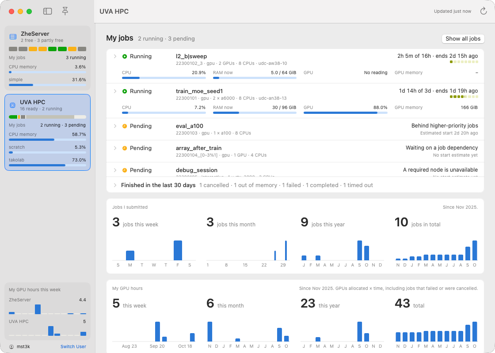
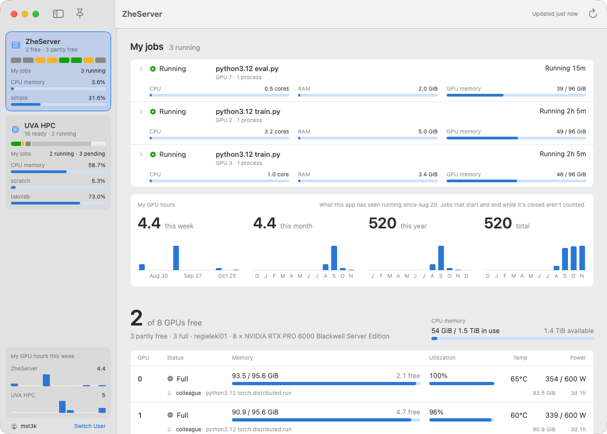
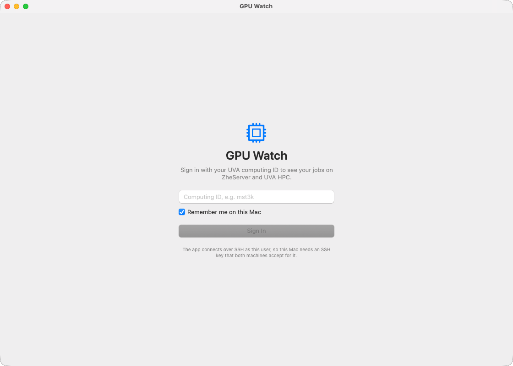

# GPU Watch

A small Mac app for people who run GPU jobs on the lab server **ZheServer** and on **UVA HPC** (Rivanna/Afton). It answers the questions you'd otherwise ask with a handful of SSH commands: which GPUs are free right now, how my jobs are doing, what they're actually using, and how much of the lab's allocation I've spent.

It reads over SSH, signed in as you, and never changes anything on either machine.



*Screenshots use the built-in demo data, not real jobs.*

## What it shows

- **Free GPUs at a glance.** ZheServer's 8 GPUs as free, partly free or full, and UVA HPC's GPUs by type as ready, backfill, in use or offline, so you can tell whether a job would start now.
- **Your jobs.** Running, pending and recently finished jobs on both machines, each with bars for what it's using: CPU, RAM, GPU and GPU memory. Pending jobs say why they're waiting.
- **Your jobs and GPU hours** this week, month and year, and in total, on each machine.
- **Lab allocation.** Your share of the SUs the lab has used on each grant, your charges per day, and an estimate for jobs still running.
- **CPU memory and storage** for each machine, including your scratch space and the lab's shared storage.

The sidebar keeps both machines in view whichever page is open. The pin at the top left keeps the window above other apps. The app refreshes on its own, every 30 seconds for ZheServer and every 60 for UVA HPC, and stops asking the cluster while the window is hidden.



## Getting started

### 1. Check your SSH access

The app has no passwords of its own. It connects with your Mac's SSH key, so the key needs to work for your computing ID on two machines:

- **UVA HPC:** `login.hpc.virginia.edu`
- **The CS department portal:** `portal.cs.virginia.edu`. ZheServer (`regieleki01.cs.virginia.edu`) is reached through the portal and shares its home directory, so a key the portal accepts works for ZheServer too.

If you don't have a key yet, make one and copy it to both. Replace `mst3k` with your computing ID; each `ssh-copy-id` asks for your password once:

```sh
ssh-keygen -t ed25519                         # skip if ~/.ssh/id_ed25519 already exists
ssh-copy-id mst3k@portal.cs.virginia.edu
ssh-copy-id mst3k@login.hpc.virginia.edu
```

Each of these should then print your ID without asking for a password:

```sh
ssh mst3k@login.hpc.virginia.edu whoami
ssh -J mst3k@portal.cs.virginia.edu mst3k@regieleki01.cs.virginia.edu whoami
```

Off grounds, UVA HPC needs the UVA VPN.

### 2. Build and install

You need macOS 15 or later and Apple's Command Line Tools (`xcode-select --install`); Xcode itself isn't needed.

```sh
git clone https://github.com/HengHugoZhao/GPUWatch.git
cd GPUWatch
scripts/build_app.sh --install    # builds and installs /Applications/GPU Watch.app
open "/Applications/GPU Watch.app"
```

### 3. Sign in



Enter your UVA computing ID. The app connects to both machines as that user and shows that user's jobs, storage and GPU hours. If a machine doesn't accept your key for that ID, its page says so, with SSH's own message.

**Remember me on this Mac** saves the ID so the app opens straight to your pages next time. Without it, the app asks again at each launch. **Switch User** at the bottom of the sidebar signs out, forgets the saved ID and goes back to the sign-in page.

## Privacy

- Every command the app runs only reads: `nvidia-smi`, `ps`, `df` and `/proc/meminfo` on ZheServer, and Slurm's `scontrol`, `squeue`, `sacct` and `sstat`, the allocation tools and `hdquota` on UVA HPC. They're all in `Sources/GPUWatchCore/RemoteScripts.swift`.
- Nothing is sent anywhere except those two machines.
- On your Mac it keeps your computing ID if you ask it to remember you, and your ZheServer GPU hours in `~/Library/Application Support/GPU Watch/`, because ZheServer keeps no usage history of its own.
- ZheServer's GPU table shows who is using each GPU, the same as `nvidia-smi` and `ps` show anyone logged in there.

## Using it elsewhere

The machines, the Slurm account (`takolab`) and the storage paths are set in `Sources/GPUWatchCore/RemoteScripts.swift`. Another lab can point the app at its own server and account there. The UVA HPC page expects Slurm, plus UVA's `hdquota` and allocation tools for the storage and allocation sections; without those, the rest still works and those sections show an error instead.

## How the numbers are worked out

Press ⌘1 or ⌘2 to switch between the machines, and ⌘R to refresh. The pin stays on when you reopen the app.

**ZheServer** runs `nvidia-smi`, `ps`, `nproc` and `df`, and refreshes every 30 seconds. It lists your jobs, the GPUs with CPU memory beside the headline, and storage.

ZheServer has no scheduler, so a job here is worked out from processes: GPU processes with the same parent and the same command line count as one job. Only work using a GPU appears, so a CPU-only process isn't listed.

Each job shows what it's using, with more detail when you hover. Nothing is reserved on this machine, so the CPU and RAM bars are out of the whole machine:

- **CPU:** cores kept busy on average since the job started, from `ps`, not the last minute. Child processes such as data loader workers count, but ones that have already exited don't.
- **RAM:** right now, added up across the job's processes and their children. Memory that forked workers share counts once for each of them, so this can read high.
- **GPU memory:** from `nvidia-smi`, out of everything on the GPUs the job is using.

| Status | Meaning |
|---|---|
| Free | Nothing running |
| Partly free | Something is running, but at least 20% of the GPU's memory is unused |
| Full | Under 20% of the GPU's memory is unused |

**UVA HPC** runs `scontrol`, `squeue`, `sacct`, `sstat`, `mam-list-allocations`, `mam-list-transactions` and `hdquota`, and refreshes every 60 seconds. It lists your running and pending jobs, jobs finished in the last 30 days, how many jobs you submitted this week, month and year and in total, GPUs by type, storage, and the lab's allocation. Click a job or a GPU type for details. Long job lists scroll in place, on both pages, so they don't push the rest of the page down. **Show all jobs** lists every running and pending job on UVA HPC at once.

| GPU count | Meaning |
|---|---|
| Ready | Free on a healthy node with CPU and memory to spare; a job should start right away |
| Backfill | Free, but Slurm has the node planned for a queued job; a short job can still fit |
| Stranded | Unallocated, but the node lacks the 1 CPU and 6 GiB needed to run a job on it |
| In use | Allocated to a job |
| Offline | Idle on a node that is down, draining, reserved or in maintenance |

The `dedicated` partition and hidden partitions aren't counted, since they aren't open to submit to.

CPU memory appears on both pages, measured differently:

- **ZheServer:** in use is `MemTotal` minus `MemAvailable` from `/proc/meminfo`, so disk cache Linux can reclaim doesn't count. This reads a little higher than the `used` column of `free`, which excludes some memory that can't be reclaimed.
- **UVA HPC:** allocated is what Slurm has reserved for running jobs (`AllocMem`), for GPU nodes in total, per GPU type, and as a bar for each node. Click a GPU type or **Show all nodes** to see the bars. Allocation is what decides whether a new job fits, though jobs may actually be using less.

Storage appears on both pages, measured differently:

- **ZheServer:** `/p/simple` comes from `df`. It's its own volume, so this covers everyone who uses it.
- **UVA HPC:** `/home/<ID>/scratch` and `/standard/takolab` come from `hdquota`, because `df` on `/standard` reports all of UVA's shared filesystem rather than the lab's quota. `/home/<ID>/scratch` is a link to `/scratch/<ID>`, whose total is UVA's soft limit.

**Lab allocation** shows your share of what the lab has used on each grant, your own use of service units (SUs), then each grant on the `takolab` account with its dates and how much the whole lab has used. Expired grants stay collapsed until you open them, both under your share and in the grant list.

- **Your charges** cover the last 60 days, because older accounting queries don't finish in a reasonable time, and Slurm's own history is capped at 31 days per query. A histogram and a heatmap show them per day, counted on the day the job ended. The heatmap has a column per week and a row per weekday. Hover over a day in either for its amount and number of jobs. This query refreshes every 15 minutes and when one of your jobs ends, rather than every minute.
- **Your share** of a grant is what you've been charged on it over what the lab has used on it. The accounting system can't go back far enough, so your side comes from Slurm's job history: billing rate, run time and outcome, attributed to the grant open when the job ended. That matched all 84 real charges it could be checked against.
- **Your running jobs** are an estimate, shown beside the total because they aren't part of it yet. A job costs a tenth of its Slurm `billing=` value per hour (`billing=1468` for 36,742 seconds was charged 1,498 SUs), and nothing is charged until it ends. Failed, cancelled and out-of-memory jobs end up free.

**GPU hours** appear on both pages, per week, per month, for each month of this year and in total, measured differently:

- **UVA HPC:** GPUs allocated × run time from Slurm's job history, split across the weeks and months each job ran in. This includes failed and cancelled jobs, which held their GPUs even though they're free.
- **ZheServer:** the machine keeps no usage history, so the app records what it sees, in `~/Library/Application Support/GPU Watch/zheserver-gpu-usage-<ID>.json`, one file per computing ID. A process counts from when it really started to the last time the app saw it, and a GPU counts once however many of your processes share it. Work from before the first recording isn't there. A job that starts and ends while the app is closed or the Mac is asleep isn't counted, and a job that ends then loses the time after it was last seen.

**What a job actually used** appears on each running and finished job, with exact numbers when you hover. Finished jobs come from `sacct`, running ones from `sstat`, for up to 50 running jobs. Slurm keeps no record over time, so a finished job has one number for each of these:

- **CPU:** CPU time over what the job's CPUs could have done, the same as `seff`. For a running job it's the average so far, not the last minute.
- **RAM:** the peak for a finished job, and the amount right now for a running one, out of what it reserved.
- **GPU:** Slurm's figure divided by the job's GPUs. It doesn't say whether this is a peak or an average, so treat it as a rough guide. **No reading** means Slurm reported 0 for both GPU numbers, which can mean the GPU went unused or wasn't read. Some older jobs and some `interactive` jobs have no GPU numbers.
- **GPU memory:** the total across the job's GPUs, which can include memory PyTorch is holding on to after freeing it. Slurm doesn't say how much a GPU holds, so the bar's total comes from a table in the app (`HPCNode.gpuMemoryGB`), matched through the job's node. A new GPU type, or a job across several nodes, shows the amount with no bar. `swift run GPUWatchChecks --live <ID>` lists any type missing from the table.

**Job history** counts each array task as a job, by the day it was submitted. Slurm caps one query at 31 days, so the app asks for one calendar month at a time: 25 queries when it opens, then 2 about every 15 minutes or when your jobs change. So the totals for jobs and UVA HPC GPU hours go back two years.

Polling of UVA HPC stops while the window is completely hidden and catches up when it's visible again. ZheServer slows to every 5 minutes instead, to keep its GPU hours going.

## Development

```sh
scripts/build_app.sh                    # builds .build/GPU Watch.app without installing it
swift run GPUWatchChecks                # parser and classification checks
swift run GPUWatchChecks --live mst3k   # fetches both machines as that ID and prints what the app would show
```

To try the interface with the demo data in `Fixtures`, including jobs the clusters aren't showing right now, signed in as an example ID and without touching your real GPU-hours file:

```sh
open -n --env GPUWATCH_FIXTURES="$PWD/Fixtures" ".build/GPU Watch.app" --args -signedInUser mst3k
```

If the project sits in `~/Documents`, macOS may ask for permission to read it after each rebuild, and the app waits on "Connecting…" until you answer. Copying `Fixtures` somewhere else avoids that.

With the Command Line Tools alone, the `@State` macro doesn't compile because its plugin ships with Xcode. View state lives in `AppModel`, or uses `State(initialValue:)` as a plain stored property.

## License

MIT. See [LICENSE](LICENSE).
